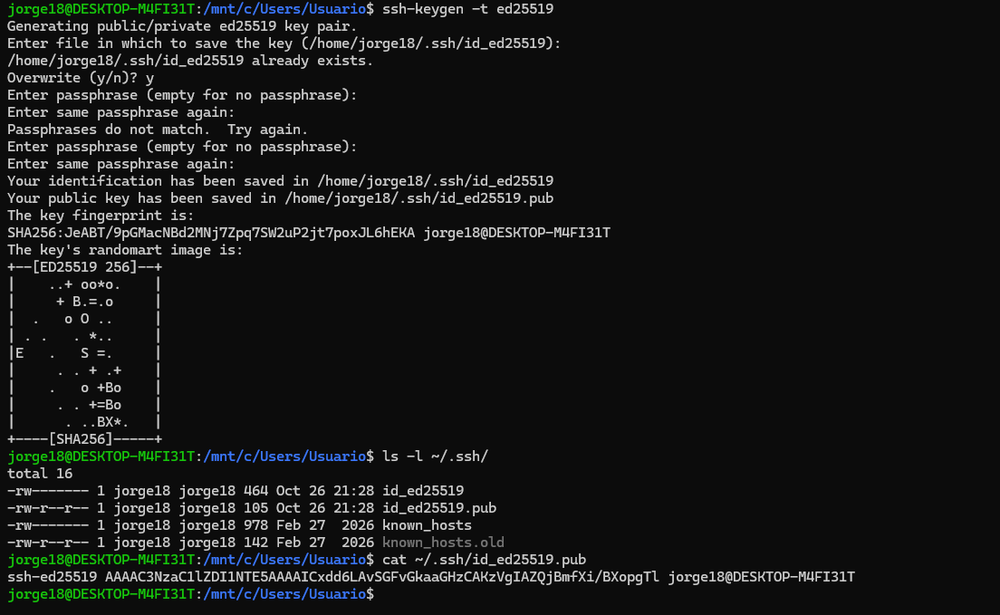
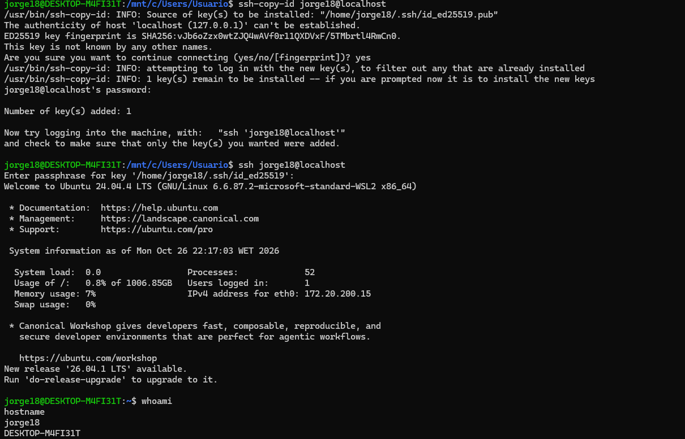

## Práctica guiada: configuración del acceso remoto mediante SSH

### Incidencia 1: El servicio SSH no está instalado

**Problema detectado**

Al ejecutar `sudo systemctl status ssh`, apareció el mensaje:

`Unit ssh.service could not be found.`

**Causa**

El sistema tenía disponible el cliente OpenSSH, pero no estaba instalado el paquete del servidor OpenSSH.

**Solución aplicada**

Se actualizaron los repositorios y se instaló el servidor SSH mediante los siguientes comandos:

```bash
sudo apt update
sudo apt install openssh-server
```

Después, se inició el servicio y se comprobó su estado:

```bash
sudo service ssh start
sudo service ssh status
```

**Evidencia**


---

### Incidencia 2: Generación de las claves SSH

#### Problema detectado: 

Al comenzar la configuración de la autenticación mediante claves SSH, era necesario generar un par de claves para identificar al usuario de forma segura al conectarse al servidor.
 
#### Causa:

Todavía no se disponía de un par de claves SSH generado para realizar la autenticación mediante clave pública.

#### Solución aplicada:

Se ejecutó el siguiente comando para generar un par de claves Ed25519:

```bash
ssh-keygen -t ed25519
```

Durante el proceso, el sistema solicitó la ubicación donde guardar las claves. Se pulsó Enter para aceptar la ubicación predeterminada:

```bash
/home/jorge18/.ssh/id_ed25519
```

A continuación, se configuró una frase de contraseña para proteger la clave privada y se confirmó introduciéndola de nuevo.

El proceso generó dos archivos:

id_ed25519: clave privada, que debe mantenerse protegida y no compartirse.

id_ed25519.pub: clave pública, que se utilizará para configurar la autenticación en el servidor remoto.

Para comprobar que los archivos se habían creado correctamente, se ejecutó:

```
ls -l ~/.ssh/
```

También se puede verificar que la clave pública existe mediante:

```
cat ~/.ssh/id_ed25519.pub
```

#### Evidencia:



---

### Incidencia 3: Configuración del acceso SSH mediante clave pública

**Problema detectado**

Se necesitaba configurar y comprobar el acceso remoto mediante SSH utilizando una clave pública, aumentando la seguridad de la conexión.

**Causa**

Era necesario configurar la autenticación mediante claves SSH y desactivar la autenticación mediante contraseña para que el acceso se realizara mediante la clave privada correspondiente.

**Solución aplicada**

**Paso 1. Copiar la clave pública al usuario**

Se ejecutó el siguiente comando para instalar la clave pública en el usuario local:

```bash
ssh-copy-id jorge18@localhost
```

La operación finalizó correctamente y mostró el mensaje `Number of key(s) added: 1`.

**Paso 2. Comprobar la conexión SSH**

Se realizó una conexión al usuario local mediante SSH:

```bash
ssh jorge18@localhost
```

Se introdujo la frase de contraseña de la clave privada y se consiguió acceder correctamente al sistema. Después, se ejecutó `whoami` para comprobar el usuario conectado, obteniendo el resultado `jorge18`.

**Paso 3. Revisar la configuración de autenticación**

Se consultaron los parámetros efectivos del servidor SSH mediante el comando:

```bash
sudo sshd -T | grep -E 'passwordauthentication|pubkeyauthentication'
```

Inicialmente, la autenticación mediante clave pública y mediante contraseña estaban habilitadas.

**Paso 4. Desactivar la autenticación mediante contraseña**

Se editó el archivo de configuración del servidor SSH:

```bash
sudo nano /etc/ssh/sshd_config
```

Se modificó la línea correspondiente para dejarla así:

```text
PasswordAuthentication no
```

De esta forma, se desactivó la autenticación mediante contraseña.

**Paso 5. Comprobar la sintaxis de la configuración**

Se ejecutó el siguiente comando para comprobar que no hubiera errores de sintaxis:

```bash
sudo sshd -t
```

No se mostró ningún mensaje de error.

**Paso 6. Aplicar los cambios**

Se recargó el servicio SSH con el comando:

```bash
sudo systemctl reload ssh
```

**Paso 7. Verificar la configuración final**

Se volvió a ejecutar el comando de comprobación:

```bash
sudo sshd -T | grep -E 'passwordauthentication|pubkeyauthentication'
```

El resultado obtenido fue:

```text
pubkeyauthentication yes
passwordauthentication no
```

Esto confirmó que la autenticación mediante clave pública seguía activada y que la autenticación mediante contraseña estaba desactivada.

**Paso 8. Realizar la prueba final**

Se volvió a ejecutar:

```bash
ssh jorge18@localhost
```

La conexión se realizó correctamente mediante la clave SSH. Se ejecutó `whoami` y se obtuvo `jorge18`, confirmando el acceso al usuario esperado.

**Evidencias**




