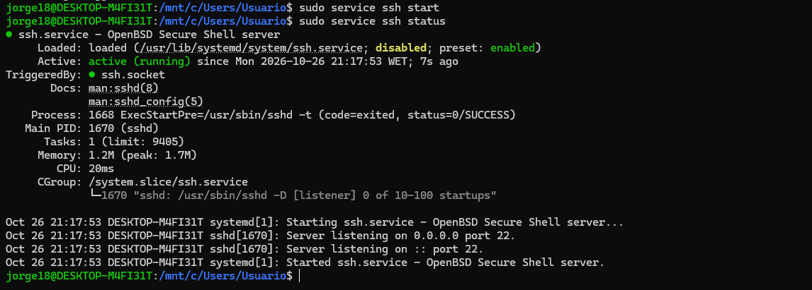

## Práctica guiada: configuración del acceso remoto mediante SSH

### Incidencia 1: El servicio SSH no está instalado

**Problema detectado**

Al ejecutar `sudo systemctl status ssh`, apareció el mensaje:

`Unit ssh.service could not be found.`

**Causa**

El sistema tenía disponible el cliente OpenSSH, pero no estaba instalado el paquete del servidor OpenSSH.

**Solución aplicada**

Se actualizaron los repositorios y se instaló el servidor SSH mediante los siguientes comandos:

```bash
sudo apt update
sudo apt install openssh-server
```

Después, se inició el servicio y se comprobó su estado:

```bash
sudo service ssh start
sudo service ssh status
```

**Evidencia**


